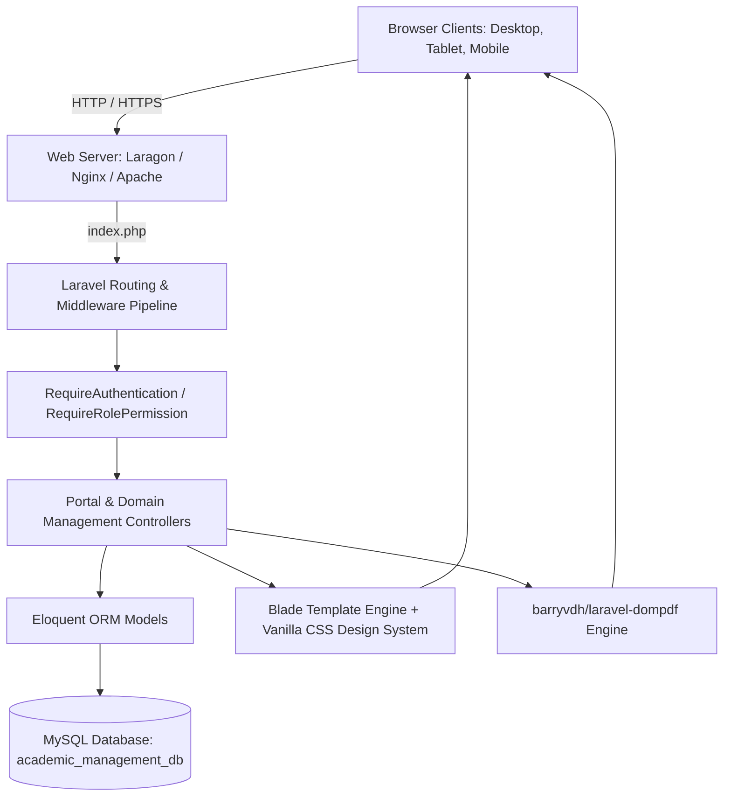
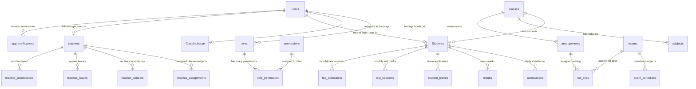
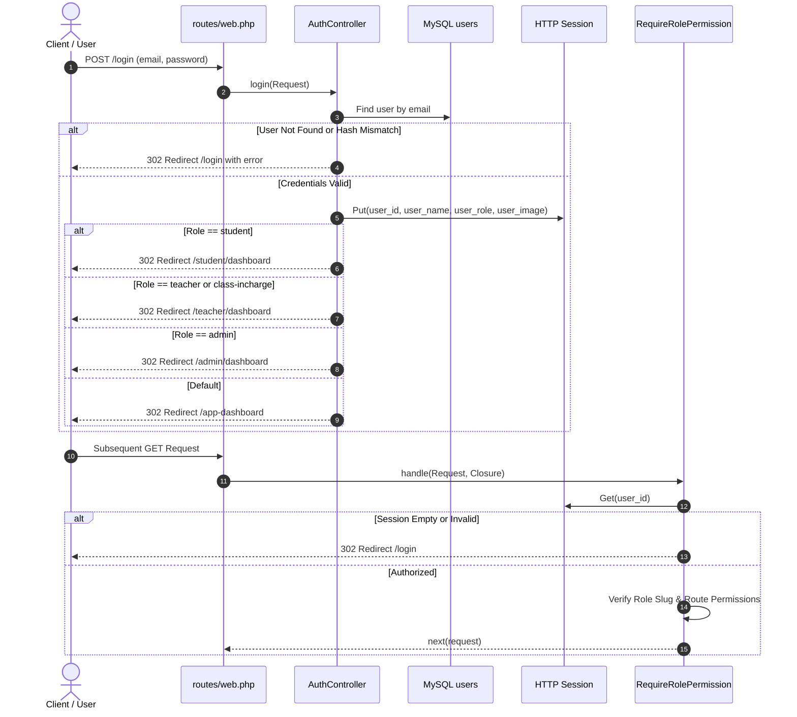
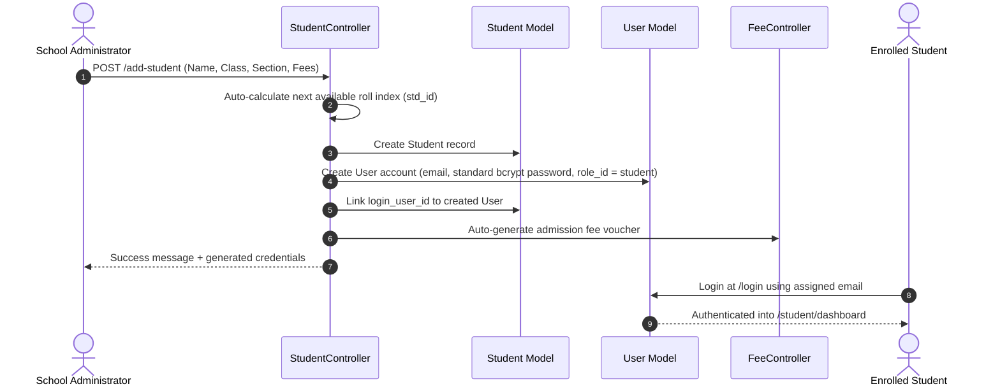
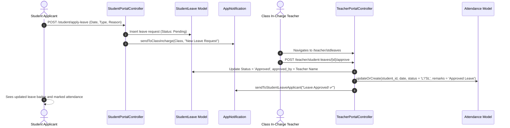

# Comprehensive Technical Documentation: Excellence Academic Management System
**Document Version:** 1.0.0  
**Target Application:** Excellence School System (Veylora Academic Management Platform)  
**System Architecture:** Monolithic Multi-Portal Web Application (Laravel 13.x / PHP 8.3 / MySQL / Vanilla CSS Design System)  
**Date of Generation:** October 2026  
**Status:** Complete Architectural & Technical Reference  

---

## Table of Contents
1. [Executive Summary & System Overview](#1-executive-summary--system-overview)
2. [System Architecture & Technology Stack](#2-system-architecture--technology-stack)
3. [Full Directory & Codebase Structure](#3-full-directory--codebase-structure)
4. [Complete Database Schema & Entity-Relationship Architecture](#4-complete-database-schema--entity-relationship-architecture)
5. [Authentication, Session Lifecycle & Granular RBAC](#5-authentication-session-lifecycle--granular-rbac)
6. [Comprehensive Module-by-Module Technical Breakdown](#6-comprehensive-module-by-module-technical-breakdown)
   - [6.1 Public Website & External Inquiries](#61-public-website--external-inquiries)
   - [6.2 Authentication & Password Lifecycle Management](#62-authentication--password-lifecycle-management)
   - [6.3 Student Portal Engine](#63-student-portal-engine)
   - [6.4 Teacher Portal & Class In-Charge Engine](#64-teacher-portal--class-in-charge-engine)
   - [6.5 Admin & Head Management Authority Portal](#65-admin--head-management-authority-portal)
   - [6.6 Academic Foundation Modules (Classes, Sections, Courses, Subjects)](#66-academic-foundation-modules)
   - [6.7 Examination, Seating Arrangements & Roll Slips](#67-examination-seating-arrangements--roll-slips)
   - [6.8 Financial Management & Fee Processing Engine](#68-financial-management--fee-processing-engine)
   - [6.9 Attendance & Leave Processing Engines](#69-attendance--leave-processing-engines)
   - [6.10 Real-Time Notification & Polling Engine](#610-real-time-notification--polling-engine)
7. [Frontend Architecture, UI Design System & Component Library](#7-frontend-architecture-ui-design-system--component-library)
8. [Cross-Module Data Flows & End-to-End Workflows](#8-cross-module-data-flows--end-to-end-workflows)
9. [Technical Audit: Detected Bugs, Inconsistencies & Security Vulnerabilities](#9-technical-audit-detected-bugs-inconsistencies--security-vulnerabilities)
10. [Architectural Roadmap & Improvement Recommendations](#10-architectural-roadmap--improvement-recommendations)

---

## 1. Executive Summary & System Overview

The **Excellence School System** (also referenced as **Veylora Academic Management System**) is an enterprise-grade academic management monolithic application built on modern PHP and Laravel. It is engineered to govern all critical operational, academic, administrative, and financial processes of an educational institution.

### Core Objectives
1. **Multi-Role Portal Monolith:** Delivers three strictly segregated, purpose-built portals (Student Portal, Teacher Portal with specialized Class In-Charge authority, and Admin/Head Management Portal), alongside a public informational web presence.
2. **End-to-End Student Lifecycle:** Handles admission intake, class/section allocations, dynamic subject selections, fee voucher billing and payment tracking, exam seating generation, monthly progress/test tracking, and report card synthesis.
3. **Faculty & Staff Operations:** Governs teacher directories, subject/class assignments, digital punch-in/punch-out attendance, course outline distribution, monthly test mark recording, leave applications, and automated monthly salary disbursement with PDF pay slips.
4. **Administrative Oversight:** Centralizes institution-wide leave approval pipelines, class in-charge delegation, real-time in-app notification dispatching, role and permission provisioning, and examination seating arrangement calculators.
5. **Aesthetic & Responsive UX:** Incorporates a custom-crafted Vanilla CSS design system combining Linear-inspired glassmorphism with Duolingo-style micro-interactions, complete light/dark theme toggles, and fully responsive layouts across mobile, tablet, and desktop screens.

---

## 2. System Architecture & Technology Stack



### Technology Stack Matrix
| Layer | Technology | Version / Specification | Rationale & Usage |
|---|---|---|---|
| **Language Runtime** | PHP | `^8.3` | High-performance modern backend language with typed properties and match expressions |
| **Backend Framework** | Laravel | `^13.17` | Monolithic framework providing routing, MVC architecture, Eloquent ORM, and Blade |
| **Database** | MySQL | `8.0+` (via Laragon) | Relational SQL storage utilizing foreign key constraints and transactional integrity |
| **PDF Generation** | DomPDF via `barryvdh/laravel-dompdf` | `v3.x` | Server-side HTML-to-PDF rendering for fee vouchers, roll number slips, and pay slips |
| **Frontend Templates**| Laravel Blade | Native | Server-side rendered markup with reusable component partials and layouts |
| **Styling & CSS** | Pure Vanilla CSS | Custom Design System | CSS Custom Properties (CSS variables), CSS Grid, Flexbox, Glassmorphism, Theme Switching |
| **Typography** | Google Fonts | Plus Jakarta Sans & Inter | Modern geometric headings with high-legibility body copy |
| **Iconography** | Bootstrap Icons | `v1.11.3` | Vector icon font for dashboard indicators, navigation pills, and interactive actions |
| **Client Scripting** | Vanilla JavaScript | ES6+ | Fetch API / AJAX for live polling, modal popups, dynamic roll lookups, theme toggling |
| **Environment** | Windows 11 / Laragon | Local Dev Stack | Local WAMP-style hosting with PHP CLI, MySQL, and Artisan background servers |

---

## 3. Full Directory & Codebase Structure

```
c:\laragon\www\Laravel\ai-academic-management-system
├── app/
│   ├── Http/
│   │   ├── Controllers/
│   │   │   ├── Admin/
│   │   │   │   └── AdminPortalController.php     # Comprehensive Admin Portal handler (10 tabs)
│   │   │   ├── Auth/
│   │   │   │   └── AuthController.php            # Login, Signup, Password resets & settings
│   │   │   ├── Management/
│   │   │   │   ├── ArrangementController.php     # Seating arrangements & hall allocations
│   │   │   │   ├── AttendanceController.php      # Class-wide student attendance sheets
│   │   │   │   ├── ClassController.php           # Class definitions & seating capacity
│   │   │   │   ├── CourseController.php          # Academic courses management
│   │   │   │   ├── DashboardController.php       # Legacy central management dashboard
│   │   │   │   ├── FeeController.php             # Fee structures & voucher collections
│   │   │   │   ├── NotificationController.php    # AJAX Notification polling and clearing API
│   │   │   │   ├── ResultController.php          # Single/Class examination marks & grading
│   │   │   │   ├── RoleController.php            # RBAC roles, class in-charges & access requests
│   │   │   │   ├── RollSlipController.php        # Exam roll number slips & date sheets
│   │   │   │   ├── SectionController.php         # Section entities (Red, Blue, Green, etc.)
│   │   │   │   ├── StudentController.php         # Student directory, CRUD & report cards
│   │   │   │   ├── SubjectController.php         # Subject definitions per class
│   │   │   │   ├── TeacherController.php         # Faculty directory & assignment management
│   │   │   │   ├── TestSessionController.php     # Monthly academic test tracking & printable sheets
│   │   │   │   └── UserController.php            # System users management
│   │   │   ├── Student/
│   │   │   │   └── StudentPortalController.php   # Complete Student Portal experience & downloads
│   │   │   └── Teacher/
│   │   │       └── TeacherPortalController.php   # Teacher & Class In-charge classroom workspace
│   │   └── Middleware/
│   │       ├── RequireAuthentication.php         # Ensures user_id is in current session
│   │       └── RequireRolePermission.php         # Strict role and permission gateway
│   └── Models/                                   # 26 Eloquent ORM Models
│       ├── AppNotification.php
│       ├── Arrangement.php
│       ├── Attendance.php
│       ├── Classes.php
│       ├── ClassIncharge.php
│       ├── Course.php
│       ├── CourseOutline.php
│       ├── Exam.php
│       ├── ExamSchedule.php
│       ├── FeeCollection.php
│       ├── FeeStructure.php
│       ├── Permission.php
│       ├── Result.php
│       ├── Role.php
│       ├── RollSlip.php
│       ├── Section.php
│       ├── Student.php
│       ├── StudentLeave.php
│       ├── Subject.php
│       ├── Teacher.php
│       ├── TeacherAccessRequest.php
│       ├── TeacherAssignment.php
│       ├── TeacherAttendance.php
│       ├── TeacherLeave.php
│       ├── TeacherSalary.php
│       ├── TestSession.php
│       └── User.php
├── config/                                       # App, database, session, auth configurations
├── database/
│   ├── factories/                                # Model factories for testing
│   ├── migrations/                               # 45+ Migration files structuring MySQL schema
│   └── seeders/                                  # Database seeders for initial setup
├── public/
│   ├── css/                                      # Modular and portal-specific stylesheets
│   │   ├── admin-portal.css                      # Admin Portal layout, cards, tabs, and styles
│   │   ├── teacher-portal.css                    # Teacher Portal styles & matching white glass navbar
│   │   ├── student-portal.css                    # Student Portal styles & metric cards
│   │   ├── global.css                            # Global CSS variables & reset rules
│   │   └── login.css                             # Authentication screen styles
│   ├── js/
│   │   ├── common/notifications.js               # Polling engine for header notification bells
│   │   ├── student-portal.js                     # Student portal interactivity & theme handling
│   │   └── teacher/teacher-portal-page.js        # Teacher portal interactions & modals
│   └── upload/                                   # File upload storage (avatars, outlines, vouchers)
├── resources/
│   └── views/
│       ├── admin/                                # Admin portal master layout & tab partials
│       ├── auth/                                 # Login, signup, password reset blades
│       ├── pdf/                                  # DomPDF templates (Roll slips, Vouchers, Payslips)
│       ├── student/                              # Student portal master blade & printable tests
│       ├── teacher/                              # Teacher portal master blade & payslip print
│       ├── teacher-layout.blade.php              # Teacher shell & navigation layout
│       ├── student-layout.blade.php              # Student shell & navigation layout
│       ├── layout.blade.php                      # Legacy/Core management shell layout
│       └── landing.blade.php                     # Public website landing page
└── routes/
    ├── web.php                                   # Monolithic application routes (230 lines)
    └── console.php                               # Artisan console commands
```

---

## 4. Complete Database Schema & Entity-Relationship Architecture

The database `academic_management_db` contains over 25 tables. Below is the detailed structural specification of every table and relationship:



### Table Definitions

#### 1. `users`
Primary identity and authentication table for all portal actors.
* `id` (bigint unsigned, PK, auto-increment)
* `name` (varchar 255): Full display name of the account holder.
* `username` (varchar 255, nullable): Optional login identifier.
* `email` (varchar 255, unique): Official email used for authentication.
* `phone` (varchar 255, nullable): Contact phone number.
* `image` (varchar 255, nullable): Profile avatar file path.
* `password` (varchar 255): Bcrypt-hashed password.
* `role_id` (bigint unsigned, FK -> `roles.id`, nullable): Role relationship.
* `must_change_password` (boolean, default 0): Forces password reset on initial login.
* `password_prompt_dismissed` (boolean, default 0): Flag to suppress force-change prompt.
* `timestamps` (`created_at`, `updated_at`).

#### 2. `roles` & `permissions`
Role-Based Access Control configuration.
* `roles`: `id`, `name` (Admin, Teacher, Class Incharge, Student), `slug` (`admin`, `teacher`, `class-incharge`, `student`), `description`, `is_system` (boolean lock).
* `permissions`: `id`, `name` (e.g. `students.create`, `attendance.view`), `label`, `module`.
* `role_permission`: Pivot table connecting `role_id` and `permission_id`.

#### 3. `Students` (Note: Table name is PascalCase)
Core student academic records.
* `id` (int unsigned, PK, auto-increment).
* `std_id` (varchar 50, nullable): Class-specific sequential roll index (`1`, `2`, `3`...).
* `registration_no` (varchar 100, nullable, unique): Permanent institutional registration number.
* `first_name`, `last_name`, `name` (varchar 255): Names.
* `email` (varchar 255, nullable): Student portal login email.
* `phone_no`, `emergency_phone` (varchar 50): Contact details.
* `class` (varchar 50): Assigned class (e.g., `Playgroup`, `One`, `TEN`).
* `section` (varchar 50): Assigned section (`Red`, `Blue`, `Green`).
* `image` (varchar 255, nullable): Student photo path.
* `user_id` (bigint unsigned, nullable): Creator administrative user ID.
* `login_user_id` (bigint unsigned, FK -> `users.id`, nullable): Portal user account reference.
* `subject` (text, nullable): JSON / comma-separated list of active subjects.
* `total_marks`, `obtained_marks` (decimal 8,2, default 0): Aggregate cumulative marks.
* `monthly_fee`, `admission_fee`, `test_session_fee` (decimal 10,2): Specific fee rates.

#### 4. `teachers`
Teacher directory and faculty records.
* `id` (int unsigned, PK, auto-increment).
* `teacher_name` (varchar 255): Faculty member name.
* `teacher_email` (varchar 255): Email address.
* `teacher_phone` (varchar 50): Contact number.
* `teacher_image` (varchar 255, nullable): Profile picture path.
* `course` (varchar 255, nullable): Primary course taught.
* `user_id` (bigint unsigned, nullable): Admin creator user ID.
* `login_user_id` (bigint unsigned, FK -> `users.id`, nullable): Linked portal user account.
* `timestamps` (`created_at`, `updated_at`).

#### 5. `class_incharges`
Delegates specific classes to faculty members with elevated classroom authority.
* `id` (bigint unsigned, PK, auto-increment).
* `user_id` (bigint unsigned, FK -> `users.id`): Teacher portal user.
* `teacher_id` (int unsigned, FK -> `teachers.id`): Associated teacher record.
* `class_id` (int unsigned, FK -> `classes.id`): Governed class.
* `assigned_by` (bigint unsigned, FK -> `users.id`): Admin who performed delegation.
* `timestamps` (`created_at`, `updated_at`).

#### 6. `classes` & `sections`
Institutional academic hierarchy.
* `classes`: `id`, `class_name` (e.g., `Pre-KG`, `ONE`, `TEN`), `class_no` (integer sorting order `0` to `12`), `chairs` (room seating capacity), `user_id`.
* `sections`: `id`, `section_name` (e.g., `Red`, `Blue`), `room_no`, `user_id`.

#### 7. `subjects` & `courses`
Curriculum definitions.
* `subjects`: `id`, `subject_name`, `total_marks`, `passing_marks`, `class_id`, `class_name`, `user_id`.
* `courses`: `id`, `course_code`, `course_name`, `description`, `credits`, `user_id`.

#### 8. `arrangements`, `exams`, `exam_schedules`, `roll_slips`
Examination hall organization and date sheet issuance.
* `arrangements`: `id`, `title`, `room_number`, `capacity`, `class_id`, `allocated_chairs`.
* `exams`: `id`, `name` (e.g., `Annual Examination 2026`), `session`, `user_id`.
* `exam_schedules`: `id`, `exam_id`, `subject_id`, `subject_name`, `exam_date`, `start_time`, `end_time`.
* `roll_slips`: `id`, `exam_id`, `student_id`, `arrangement_id`, `roll_number`, `datesheet` (JSON payload of timetable), `instructions`.

#### 9. `attendances` & `teacher_attendances`
Digital daily attendance logs.
* `attendances`: `id`, `student_id`, `date` (date), `status` (`P` = Present, `A` = Absent, `L` = Leave, `SL` = Sick Leave, `CL` = Casual Leave), `class_name`, `section_name`, `remarks`, `user_id`.
* `teacher_attendances`: `id`, `teacher_id`, `date` (date), `status` (`Present`, `Absent`, `Leave`, `Half Day`), `punch_in` (time), `punch_out` (time), `remarks`.

#### 10. `student_leaves` & `teacher_leaves`
Leave request pipelines.
* `student_leaves`: `id`, `student_id`, `student_name`, `student_class`, `student_section`, `leave_type`, `leave_date`, `reason`, `status` (`Pending`, `Approved`, `Rejected`), `approved_by`, `timestamps`.
* `teacher_leaves`: `id`, `teacher_id`, `leave_type`, `leave_date`, `reason`, `status` (`Pending`, `Approved`, `Rejected`), `approved_by`, `timestamps`.

#### 11. `fee_structures` & `fee_collections`
Institutional tuition and billing system.
* `fee_structures`: `id`, `class_name`, `admission_fee`, `monthly_tuition_fee`, `examination_fee`, `computer_lab_fee`, `sports_fee`, `utility_charges`, `total_monthly_fee`.
* `fee_collections`: `id`, `student_id`, `voucher_no` (unique voucher code), `month` (e.g. `2026-10`), `tuition_fee`, `exam_fee`, `lab_fee`, `arrears`, `discount`, `total_amount`, `paid_amount`, `status` (`Paid`, `Unpaid`, `Partial`), `payment_date`, `payment_method`.

#### 12. `teacher_salaries`
Payroll records for faculty.
* `id`: PK.
* `teacher_id` (FK -> `teachers.id`).
* `month` (varchar `YYYY-MM`).
* `base_salary`, `bonus`, `deductions`, `net_salary` (decimal 10,2).
* `payment_status` (`Paid`, `Pending`).
* `payment_date`, `payment_method`, `remarks`.

#### 13. `test_sessions`
Monthly academic performance assessments.
* `id`: PK.
* `student_id` (FK -> `Students.id`).
* `month` (`January` through `December`).
* `subject_name`, `total_marks`, `obtained_marks`, `percentage`, `grade`, `remarks`.

#### 14. `course_outlines`
Curriculum documents uploaded by teachers.
* `id`: PK.
* `teacher_id` (FK -> `teachers.id`).
* `class_name`, `section_name`, `subject_name`.
* `title`, `file_path`, `description`, `timestamps`.

#### 15. `app_notifications`
In-app notification dispatch queue.
* `id`: PK.
* `user_id` (recipient user).
* `sender_id` (originating user, nullable).
* `title`, `message` (text).
* `type` (`info`, `success`, `warning`, `danger`, `leave`, `fee`, `announcement`).
* `action_url` (clickable target link).
* `icon` (Bootstrap icon class).
* `is_read` (boolean, default 0).
* `timestamps`.

---

## 5. Authentication, Session Lifecycle & Granular RBAC

The system employs a custom session-based authentication layer designed for high reliability across distinct multi-user portals without colliding standard guard states.

### 1. Authentication Flow


### 2. Role-Based Access Control (RBAC) Matrix
The RBAC engine is enforced by `App\Http\Middleware\RequireRolePermission`:

| Portal / Module Route Pattern | Allowed Roles | Enforced Rules & Restrictions |
|---|---|---|
| **`/admin/*`** | `admin` | Full read/write authority across the entire school database. |
| **`/teacher/*`** | `teacher`, `class-incharge`, `admin` | Can only view their own classes/subjects. Class in-charges gain approval access over student leaves for their class. Regular teachers cannot approve leaves without incharge role. |
| **`/student/*`** | `student` | Read-only view of their personal attendance, exam results, test sessions, fee vouchers, and downloadable course outlines. Read-write restricted strictly to applying for leave and paying personal fees. Non-GET requests outside `/student/*` are blocked with HTTP 403. |
| **`/roles/*`, `/teacher-access-requests/*`** | `admin` | Restricted strictly to super-administrators. |
| **`/add-student`, `/students/*`** | `admin`, authorized faculty | Students are blocked from modifying student records. In-charges can only update students within their designated class. |
| **`/attendance`** | `admin`, `class-incharge` | Daily attendance entry requires `attendance.create` permission. |

---

## 6. Comprehensive Module-by-Module Technical Breakdown

### 6.1 Public Website & External Inquiries
* **Routes:**
  * `GET /`: Landing page showcasing school achievements, curriculum, statistics, tour video, and call-to-action buttons.
  * `GET /about`: Institutional history, vision, executive leadership, and faculty credentials.
  * `GET /programs`: Early childhood, primary, middle, and high school academic pathways.
  * `GET /careers`: Faculty and administrative vacancy announcements.
  * `POST /careers/apply`: Public job application submission handler.
  * `GET /contact`: Campus location map, contact information, and inquiry form.
  * `POST /contact`: Validates and receives public inquiries (`name`, `email`, `subject`, `message`).
* **Controllers & Views:**
  * Directly rendered via closures returning `landing.blade.php`, `about.blade.php`, `programs.blade.php`, `careers.blade.php`, and `contact.blade.php`.
* **Data Flow:** Public inputs are validated and flashed to session with success notifications.

### 6.2 Authentication & Password Lifecycle Management
* **Controller:** `App\Http\Controllers\Auth\AuthController`
* **Features:**
  1. `loginForm()` & `login(Request)`: Validates credentials, checks Bcrypt hashes, establishes session credentials (`user_id`, `user_name`, `user_role`, `user_image`), and routes actors to their respective portal dashboard.
  2. `signupForm()` & `signup(Request)`: Public user registration for student/parent inquiries.
  3. `forgotPasswordForm()` & `sendPasswordResetLink(Request)`: Generates 64-character cryptographic tokens stored in `password_reset_requests` table.
  4. `resetPasswordForm()` & `resetPassword(Request)`: Validates token expiration, hashes new password, updates `users.password`, and purges used tokens.
  5. `editPassword()` & `updatePassword(Request)`: Mandatory first-time password reset and voluntary account security updates.
  6. `dismissPasswordPrompt(Request)`: Sets `password_prompt_dismissed = 1` allowing users to bypass password change prompts.

### 6.3 Student Portal Engine
* **Controller:** `App\Http\Controllers\Student\StudentPortalController`
* **View:** `resources/views/student/portal.blade.php` (utilizing `student-layout.blade.php`)
* **Modules & Tabs:**
  1. **Dashboard (`/student/dashboard`):** Real-time KPI cards: Attendance rate (%), outstanding fee sum, latest exam grade, and downloadable academic timetable.
  2. **Profile (`/student/profile`):** Personal details, registration number, father's name, assigned section, and profile photo update.
  3. **Fees & Invoices (`/student/fees`):** Displays month-by-month fee voucher history with payment statuses (`Paid`, `Unpaid`). Includes interactive `POST /student/pay-fee/{id}` mock gateway and `GET /student/fee-voucher/{id}/download` PDF rendering via DomPDF.
  4. **Academics (`/student/academics`):** Lists all active subjects enrolled in the student's current class along with assigned teachers.
  5. **Attendance Log (`/student/attendance`):** Visual calendar and historical log tracking present days, absences, and leaves.
  6. **Exam Results (`/student/results`):** Official mark sheets categorized by exam terms (Mid-Term, Final Term) with grading calculators.
  7. **Roll Number Slips (`/student/slips`):** Displays issued roll slips, assigned exam room, desk number, and date sheet download.
  8. **Leave Management (`/student/leaves`):** Interactive leave application form (`POST /student/apply-leave`). Automatically creates `student_leaves` record and triggers real-time notification to the designated Class In-Charge.
  9. **Monthly Test Sessions (`/student/tests`):** Comprehensive scorecard across 12 monthly test cycles with printable report card (`/student/test-sessions/{month}/download`).
  10. **Course Outlines (`/student/outlines`):** Curriculum syllabi and documents uploaded by assigned teachers with direct download capability.

### 6.4 Teacher Portal & Class In-Charge Engine
* **Controller:** `App\Http\Controllers\Teacher\TeacherPortalController`
* **View:** `resources/views/teacher/portal.blade.php` (utilizing `teacher-layout.blade.php`)
* **Modules & Tabs:**
  1. **Dashboard (`/teacher/dashboard`):** Faculty overview: Active class, assigned subjects, today's punch-in status, pending student leaves badge, and "Back to Website" direct navigation.
  2. **Digital Biometric Punch-In/Out (`punchIn`, `punchOut`):** Daily self-attendance tracking. Records current server timestamp in `teacher_attendances`.
  3. **Assigned Classes (`/teacher/classes`):** Detailed overview of classes, student rosters, and curriculum schedules.
  4. **Faculty Profile (`/teacher/profile`):** Contact number, academic credentials, and security credentials.
  5. **Attendance Log (`/teacher/attendance`):** Monthly attendance sheet showing worked hours, half days, and leave deductions.
  6. **Leave Application (`/teacher/leaves`):** Faculty leave submission (`POST /teacher/apply-leave`). Restricts to institutional quota (e.g. 2 paid leaves/month) and dispatches alert to Admin portal.
  7. **Class Co-Teachers (`/teacher/coteachers`):** Directory of other instructors teaching different subjects in the same class.
  8. **Class Students (`/teacher/students`):** Complete student roster with quick contacts and academic statuses.
  9. **Results & Test Marks Entry (`/teacher/results`, `/teacher/tests`):** Class In-Charge and subject teachers can input marks (`POST /teacher/test-marks/update`), which automatically computes percentages, letter grades (`A+`, `A`, `B`, `C`, `F`), and updates student records.
  10. **Course Outlines Upload (`POST /teacher/upload-outline`):** File upload modal saving document to `public/upload/outlines` and inserting record into `course_outlines`.
  11. **My Salary (`/teacher/salary`):** Historical pay slip archive with instant PDF download (`/teacher/salary-slip/{id}`).
  12. **Student Leaves Approval (`/teacher/stdleaves`):** Exclusive to Class In-Charges. In-Charges can Approve or Reject leave requests. Upon approval, the system **automatically writes to daily attendance** as an authorized leave (`SL`, `CL`, or `L`) and notifies the student.

### 6.5 Admin & Head Management Authority Portal
* **Controller:** `App\Http\Controllers\Admin\AdminPortalController`
* **View:** `resources/views/admin/portal.blade.php` (utilizing `admin/layout.blade.php`)
* **Modules & Tabs:**
  1. **Executive Dashboard (`/admin/dashboard`):** Institution-wide statistics: Total enrolled students, active faculty, total classes, monthly fee collection aggregates, and pending approval alerts.
  2. **Leaves Approval Hub (`/admin/leaves`):** Consolidated management of both Student Leaves and Teacher Leaves. Approvals sync directly into attendance records.
  3. **Teacher Salaries Management (`/admin/salaries`):** Payroll generation tool. Calculates basic salary + bonuses - deductions, generates salary vouchers, and produces official printable salary slips via DomPDF.
  4. **Students Directory (`/admin/students`):** Filterable roster with full profile views, enrollment status, and direct report card generation.
  5. **Teachers Directory (`/admin/teachers`):** Faculty profiles, assigned subjects, and employment statuses.
  6. **Student Fees Management (`/admin/fees`):** Class-wise fee structure configuration and real-time fee collection tracker.
  7. **Attendance Monitoring (`/admin/attendance`):** Institution-wide attendance matrix for students and faculty across specific dates.
  8. **Academics Hub (`/admin/academics`):** Consolidated configuration of Classes, Sections, Subjects, Courses, Examination Schedules, and Roll Number Slips.
  9. **Roles & Permissions (`/admin/roles`):** RBAC configuration, custom role creation, permission toggles, and Class In-Charge delegation.
  10. **System Accounts (`/admin/users`):** User management, password resets, and account status toggles.

### 6.6 Academic Foundation Modules
* **Controllers:** `ClassController`, `SectionController`, `CourseController`, `SubjectController`
* **Features:**
  * Class creation with capacity and sorting index (`class_no`).
  * Section creation with room allocations.
  * Subject creation with maximum marks and passing mark thresholds per class.
  * Academic course definitions.

### 6.7 Examination, Seating Arrangements & Roll Slips
* **Controllers:** `ArrangementController`, `RollSlipController`, `ResultController`
* **Features:**
  * Exam creation and datesheet assembly (`ExamSchedule`).
  * Physical hall seating arrangements (`arrangements`), mapping classes to rooms and seat counts.
  * Automated Roll Number Slip issuance (`RollSlipController::store`) matching students to examination rooms.
  * Class-wide roll slip compilation and downloadable PDF printing via DomPDF.
  * Result recording with automatic GPA and grade computation.

### 6.8 Financial Management & Fee Processing Engine
* **Controller:** `FeeController`
* **Features:**
  * Dynamic Class-wise fee structures (`fee_structures`) with itemized breakdowns: admission, tuition, lab, sports, and utilities.
  * Bulk monthly voucher issuance (`fee_collections`) generating unique serial numbers (e.g. `VCH-202610-0042`).
  * Printable 3-copy bank/school/student fee voucher PDF layout (`/fee-structure/voucher/{id}`).

### 6.9 Attendance & Leave Processing Engines
* **Controllers:** `AttendanceController`, `TeacherPortalController`, `AdminPortalController`
* **Features:**
  * Matrix-style daily student attendance entry.
  * Dual-layer leave processing:
    1. Student submits leave -> Class Incharge receives notification -> Incharge approves -> Attendance record marked as `L`/`SL`/`CL`.
    2. Faculty submits leave -> Admin receives notification -> Admin approves -> Teacher attendance logged as `Leave`.

### 6.10 Real-Time Notification & Polling Engine
* **Controller:** `NotificationController`
* **Model:** `AppNotification`
* **Client Script:** `public/js/common/notifications.js`
* **Features:**
  * Asynchronous notification dispatching on critical business events (Leave approval, fee generation, announcement broadcast).
  * Client-side polling every 10–15 seconds via `GET /api/notifications`.
  * Visual notification bell counter with sound effects and instant mark-as-read AJAX triggers.

---

## 7. Frontend Architecture, UI Design System & Component Library

The application utilizes a custom-built, modern Vanilla CSS Design System with zero external CSS frameworks (avoiding Bootstrap/Tailwind CSS conflicts in the portal layouts).

### 1. Tokenized Color Architecture
Both light and dark themes are driven by CSS custom properties declared in `:root`:

```css
:root, [data-theme="light"] {
    --bg: #F8F3EB;                   /* Warm ivory background */
    --surface: #FFFFFF;              /* Crisp card surface */
    --surface-hover: #FDF9F3;
    --border: #E8DFD5;               /* Soft border line */
    --primary: #4F46E5;              /* Vibrant Royal Indigo */
    --primary-hover: #4338CA;
    --accent: #F59E0B;               /* Amber gold indicator */
    --text: #0F172A;                 /* Slate deep black */
    --muted: #64748B;                /* Balanced secondary text */
    --navbar-bg: rgba(255, 255, 255, 0.88); /* Translucent glassmorphism */
    --navbar-border: #E5E7EB;
    --hairline-gradient: linear-gradient(90deg, #10B981 0%, #3B82F6 50%, #F59E0B 100%);
}

[data-theme="dark"] {
    --bg: #0F172A;                   /* Deep slate night */
    --surface: #1E293B;              /* Dark charcoal surface */
    --border: #334155;
    --text: #F8FAFC;
    --muted: #94A3B8;
    --navbar-bg: rgba(30, 41, 59, 0.88);
    --navbar-border: #334155;
}
```

### 2. UI Component Primitives
* **Sticky Glassmorphism Topbar (`.student-top`, `.teacher-top`, `.admin-top`):** `backdrop-filter: blur(12px)` with subtle bottom hairline gradient.
* **Hero Banners (`.student-hero`, `.admin-hero`):** Rich gradient background featuring floating badges, session pills, quick action buttons, and integrated tab navigation bars.
* **Interactive Metric Cards (`.analytics-stat-card`):** High-contrast KPI counters with micro-animations on hover.
* **Session Indicator Pill (`.top-session-pill`):** Soft lavender capsule with an active pulsing emerald green dot (`animation: pulseGlow 2s infinite`).
* **Back to Website Button (`.btn-back-website`):** Translucent glass pill with rotating globe and hovering up-right arrow providing seamless navigation between internal portals and public web pages.

---

## 8. Cross-Module Data Flows & End-to-End Workflows

### Workflow 1: Complete Student Onboarding & Login Access Generation


### Workflow 2: Leave Processing & Attendance Synchronization


---

## 9. Technical Audit: Detected Bugs, Inconsistencies & Security Vulnerabilities

During this comprehensive read-only analysis of the codebase, several technical inconsistencies, edge-case bugs, and architectural debts were identified. These are documented below for future engineering consideration:

### 1. Database Table Naming Inconsistency (PascalCase vs snake_case)
* **Location:** `app/Models/Student.php` (`protected $table = 'Students';`) vs `app/Models/Teacher.php` (`protected $table = 'teachers';`).
* **Issue:** MySQL on Linux/Docker is case-sensitive by default (`lower_case_table_names=0`). In local Windows/Laragon environments, table names are case-insensitive. Deploying this codebase directly to an Ubuntu/Linux production server will trigger `Table 'academic_management_db.students' doesn't exist` errors.
* **Recommended Fix:** Standardize all table names in migrations and models to lowercase plural snake_case (`students`).

### 2. Duplicated Controller Classes in Namespaces
* **Location:**
  * `app/Http/Controllers/AdminPortalController.php` AND `app/Http/Controllers/Admin/AdminPortalController.php`
  * `app/Http/Controllers/TeacherPortalController.php` AND `app/Http/Controllers/Teacher/TeacherPortalController.php`
  * `app/Http/Controllers/StudentPortalController.php` AND `app/Http/Controllers/Student/StudentPortalController.php`
* **Issue:** Duplicate controller classes exist in both the root `Controllers` namespace and sub-namespaces (`Admin\`, `Teacher\`, `Student\`). While `routes/web.php` references the sub-namespaced controllers, having duplicate root files creates confusion and risks accidental edits to dead code.
* **Recommended Fix:** Safely archive and remove the root-level legacy controllers.

### 3. Session-Based Custom Auth vs Native Laravel Guards
* **Location:** `RequireAuthentication.php`, `RequireRolePermission.php`, `AuthController.php`.
* **Issue:** Authentication relies on manual session variables (`$request->session()->put('user_id', ...)`) instead of Laravel's built-in `Auth::login($user)`.
* **Impact:** Features like `Auth::user()`, route middleware `auth`, standard authorization gates, and multi-guard configurations cannot be natively utilized without custom wrappers.
* **Recommended Fix:** Refactor to standard Laravel authentication guards (`auth:web`, `auth:teacher`, `auth:student`).

### 4. Direct Public Upload Storage vs Symlinked Storage
* **Location:** `TeacherPortalController.php` and `StudentController.php`.
* **Issue:** Files (profile photos, course outlines) are saved directly into `public/upload/` instead of `storage/app/public` with an `artisan storage:link` symlink.
* **Impact:** In modern containerized deployments (Docker, Kubernetes), files in `public/` are ephemeral and lost on container restart.
* **Recommended Fix:** Switch to `Storage::disk('public')->putFile()` with standard symbolic linking.

### 5. Missing Database Transactions on Multi-Step Cascade Writes
* **Location:** `TeacherPortalController::approveStudentLeave()` and `AdminPortalController::approveStudentLeave()`.
* **Issue:** The leave status update and the attendance `updateOrCreate` write are executed sequentially without being wrapped in `DB::transaction()`.
* **Impact:** If the attendance write fails due to a network glitch or deadlock, the leave is marked as "Approved" without attendance being updated, causing data inconsistency.
* **Recommended Fix:** Wrap multi-model operations inside `DB::transaction(function() { ... })`.

---

## 10. Architectural Roadmap & Improvement Recommendations

1. **Automated Unit & Feature Testing:**
   * Implement PHPUnit/Pest test suites covering login flows, role middleware enforcement, leave approval pipelines, and fee voucher mathematical calculations.
2. **API & Mobile App Readiness:**
   * Abstract portal controller logic into reusable Service classes (`StudentService`, `LeaveService`, `FeeService`).
   * Introduce Laravel Sanctum API tokens in `routes/api.php` to enable native Android/iOS mobile application integration.
3. **Queue-Backed Notification System:**
   * Transition `app_notifications` and email alerts from synchronous request-cycle writes to Laravel Queue Workers (`php artisan queue:work`) utilizing Redis or database queue drivers for optimal server response times.
4. **Automated Database Seeder for Demonstration & QA:**
   * Expand `database/seeders/DatabaseSeeder.php` to seed complete demo environments with pre-populated classes, assigned teachers, mock test sessions, and sample fee vouchers with a single command.

---

*End of Technical Documentation Report.*
